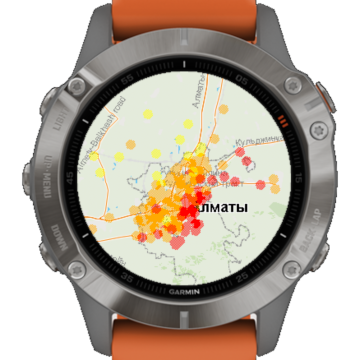

# AirMon

AirMon is a Garmin Connect IQ widget that shows the current air quality in Almaty (and
Karaganda) on your watch: a glance with a colour scale of the AQI categories and a marker at
the current value, the US AQI number and the category name (or "out of coverage"), and a
full-screen map of the city with your position on it. Data comes from
the community sensor network of the [Almaty Air Initiative](https://air.org.kz) through a
small Cloudflare Worker that hides the API key and keeps the watch traffic tiny.

 

## Reading the colors

The index is the US AQI computed from PM2.5 (EPA 2024 breakpoints). Gray means no data or
data older than 30 minutes, counted from the time of the measurement (the glance then
grays out its scale and shows "N min ago" instead of the category name).

| Category | AQI | Color |
|---|---|---|
| Good | 0-50 | green |
| Moderate | 51-100 | yellow |
| Unhealthy for sensitive groups | 101-150 | orange |
| Unhealthy | 151-200 | red |
| Very unhealthy | 201-300 | purple |
| Hazardous | 301+ | maroon |
| No data / stale | | gray |

## The map

Opening the widget shows the city. On watches with Garmin maps it is the watch's own map with a
dot per station in its category colour (the dots are dithered, so the map shows through and
dense areas read like a heat map) and a ring for your position. Press SELECT to pan and zoom
with the buttons, BACK to return to the whole city, BACK again to leave. Watches without maps
show a grid heat map of the city instead.

## Install

Side-load: download the latest
[release](../../releases/latest), take your model's file from
`AirMon-X.Y.Z-watch-prg.zip` (its README lists which file fits which watch), copy it to
`GARMIN/APPS` on the watch over USB and add AirMon to the widget loop. Allow location and
background access when asked.

Supported: 22 round-display models (fenix 6 family, fenix 8 47 mm, Forerunner 245/745/945,
MARQ, Descent Mk2, Enduro).

## How it works

```
watch (glance / widget)  -->  Cloudflare Worker (proxy/)  -->  Almaty Air Initiative API
   background refresh          5 min cache, API key            PM2.5 stations
   every 5 minutes             compact JSON
```

The watch sends its position (or the chosen city) to the Worker, which picks the nearest
stations (5 km, up to 3; a single station within 15 km otherwise), converts PM2.5 to AQI and
returns short-keyed JSON. The heat map is a 24x24 grid of categories built the same way
(3 km range per cell).

## Your own proxy

The watch app needs a Worker. Deploy your own from [proxy/](proxy/README.md) (you need an
AAI API key), then build the watch app with `PROXY_URL=https://your-worker.example`.

## Build

Needs the Connect IQ SDK 9.3.0 (SDK Manager) and a developer key at
`~/.connectiq/developer_key.der`.

```sh
make -C watch build             # .prg for DEVICE (default fenix6pro), RELEASE=1 for an optimized build
make -C watch test              # unit tests in the Connect IQ simulator
make -C watch sim               # run in the simulator
make -C watch dist VERSION=0.0.0  # watch/dist: store package (.iq) + zip of per-model .prg
npm --prefix proxy test         # proxy tests (fixtures, no API key needed)
```

`PROXY_URL` defaults to the public Worker; use `PROXY_URL=http://localhost:8787` with `npm run dev` in `proxy/`.
`scripts/ciq-docker.sh KEY_DIR <make args>` runs a watch build in the same Docker image as CI.

## Releases

Actions -> **Release** -> Run workflow (on `main`), choose `patch` / `minor` / `major`. It
builds every model and the store package and creates tag `vX.Y.Z` with a GitHub release:
`AirMon-X.Y.Z.iq` (upload it by hand at the Connect IQ developer dashboard) and
`AirMon-X.Y.Z-watch-prg.zip`. CI (every push and pull request) runs the proxy tests and
watch builds for fenix6pro, fenix6s and fenix847mm.

A fork must set up:

- repository variable `PROXY_URL`: the deployed Worker URL. The release fails if it is empty
  or contains `localhost`;
- secret `CIQ_DEVELOPER_KEY_BASE64` in the environment `release` (limited to `main`):
  `base64 -i ~/.connectiq/developer_key.der | pbcopy`. Store updates must be signed with the
  key of the first upload.

## License

Code: MIT, see [LICENSE](LICENSE).

Data: [Almaty Air Initiative](https://air.org.kz), [CC BY 4.0](https://creativecommons.org/licenses/by/4.0/).

## Privacy

The watch sends its position rounded to about 100 m (3 decimals) to the Worker, which does not log
or store it; it only logs upstream error statuses.
