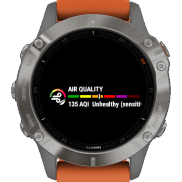

# Almaty AQI

Almaty AQI is a Garmin Connect IQ widget that shows the current air quality in Almaty (and
Karaganda) on your watch: a glance with a colour scale of the AQI categories and a marker at
the current value, the US AQI number and the category name (or "out of coverage"), and a
full-screen map of the city. The glance shows one value for the whole city, as on
dashboard.air.org.kz, not a value for your location. Data comes from the community sensor
network of the [Almaty Air Initiative](https://air.org.kz) through a small self-hosted Go
server that hides the API key, caches responses and keeps the watch traffic tiny.

 

## Reading the colors

The index is the US AQI computed from PM2.5 (EPA 2024 breakpoints). Gray means no data or
data older than 30 minutes, counted from the time of the measurement (the glance then
grays out its scale and shows "N min ago", or "N h ago" after an hour, instead of the
category name).

| Category | AQI | Color |
|---|---|---|
| Good | 0-50 | green |
| Moderate | 51-100 | yellow |
| Unhealthy for sensitive groups | 101-150 | orange |
| Unhealthy | 151-200 | red |
| Very unhealthy | 201-300 | purple |
| Hazardous | 301+ | maroon |
| No data / stale | | gray |

## The map

Opening the widget shows the city. On watches with Garmin maps it is the watch's own map with a
dot per station in its category colour (the dots are dithered, so the map shows through and
dense areas read like a heat map). There is no ring for your position on these maps: the
watch's own arrow shows it. Press SELECT to pan and zoom with the buttons, BACK to return to
the whole city, BACK again to leave. Watches without maps show a grid heat map of the city
instead, with a mark for your position that is computed on the watch.

## Install

Side-load: download the latest
[release](../../releases/latest), take your model's file from
`AlmatyAQI-X.Y.Z-watch-prg.zip` (its README lists which file fits which watch), copy it to
`GARMIN/APPS` on the watch over USB and add Almaty AQI to the widget loop. Allow location and
background access when asked.

Supported: 72 models with glances (fenix 6/7/8/9 and fenix E, epix Pro, Enduro, MARQ,
Forerunner 55/165/170/245/255/265/570/745/945/955/965/970, Descent, D2 Mach); the zip's README
has the full list.

## How it works

```
watch (glance / widget)  -->  almatyaqi-server (server/)  -->  Almaty Air Initiative API
   background refresh          cache, API key, budget       PM2.5 stations
   every 5 minutes             compact JSON
```

The watch asks the server for the city it is in. It sends its position (rounded to about
100 m) and the server only decides which city it falls into: Almaty, Karaganda or out of
coverage (`nopos` when the watch has no position yet). The glance is one value per city: for
Almaty the average of the district values AAI publishes (the number dashboard.air.org.kz
shows), for Karaganda the mean of the stations. The heat map is a 24x24 grid of categories
built from the stations (3 km range per cell); the position mark on it is computed on the
watch. The server logs no positions.

## Self-hosting the server

`server/` is a Go server that replaces the Worker. It serves `/v1/glance` and `/v1/heatmap`
(with a changed response format, see below) and is self-hosted. It keeps the AAI API key on the server (read from a file, never from
the config or the image), caches ready responses (15 minutes fresh, served stale for up to
2 hours when AAI is unreachable) and spends AAI requests from a hard budget of 80 per sliding
hour (`budget.per_hour`, at most 100) so a personal API key stays far below the provider's
limit. `GET /healthz` answers 200 without calling AAI.

The API is not the Worker's API any more: the `h`, `st`, `fb` and `me` fields are gone and
the `nopos` answer is new. Old watch builds do not work with the new server, and new watch
builds do not work with the old Worker; build the watch app against the server you deploy
(see the nginx section for `PROXY_URL`). The Cloudflare Worker in `proxy/` is the legacy
proxy that this server replaces; it still exists in the repository for now.

Config: copy [server/deploy/config.example.yaml](server/deploy/config.example.yaml) to
`/etc/almatyaqi-server/config.yaml`; only `aai.key_file` is required, everything else has a
default. Flags: `-config PATH`, `-version`.

The server logs each upstream request at info level (path, status, duration, outcome; never
the query string, headers or the key) and its effective non-secret settings at startup.

The default `cache.backend: memory` keeps everything in one process: the AAI budget is per
process (N replicas spend up to N x 80 requests per hour), and a restart resets the in-memory
budget and the failure cooldown. Every deployment that uses the same personal AAI key,
dev and test runs included, must share one Redis (`cache.backend: redis`), otherwise the
key's real limit can be exceeded.

### systemd

```sh
make -C server build                      # server/bin/almatyaqi-server (or take a release archive)
install -m 0755 server/bin/almatyaqi-server /usr/local/bin/
install -d /etc/almatyaqi-server
install -m 0644 server/deploy/config.example.yaml /etc/almatyaqi-server/config.yaml
install -m 0600 -o root -g root /dev/null /etc/almatyaqi-server/aai_key   # then put the key in it
install -m 0644 server/deploy/almatyaqi-server.service /etc/systemd/system/
systemctl daemon-reload && systemctl enable --now almatyaqi-server
```

The unit runs as a dynamic unprivileged user and hands the key over with
`LoadCredential=`, so `aai.key_file` stays `/run/credentials/almatyaqi-server.service/aai_key`.
After changing the config or the key use `systemctl restart almatyaqi-server`.

### Docker and Kubernetes

```sh
docker build -t almatyaqi-server --build-arg VERSION=0.0.0 server/
docker run --rm -p 8790:8790 \
  -v $PWD/config.yaml:/etc/almatyaqi-server/config.yaml:ro \
  -v $PWD/aai_key:/run/secrets/aai_key:ro almatyaqi-server
```

In the config set `listen: 0.0.0.0:8790` and `aai.key_file: /run/secrets/aai_key`. The key is
not in the image: in Kubernetes mount a Secret as a file at that path. The image runs as
uid/gid 65532 (distroless `nonroot`), so the key file must be readable by it: `chown 65532` it
on the host (mode 0400/0600), or in Kubernetes set the Secret volume `defaultMode: 0440` with
`securityContext.fsGroup: 65532`. With several replicas
use `cache.backend: redis` (and `redis.addr`) so they share the cache, locks and the AAI
budget. Release images are built by goreleaser for Docker Hub as `<user>/almatyaqi-server`
(linux/amd64 and linux/arm64, tags `X.Y.Z` and `latest`).

### nginx

The server speaks plain HTTP on `127.0.0.1:8790`; terminate TLS in nginx:

```nginx
location /v1/ {
    proxy_pass http://127.0.0.1:8790;
    access_log off;   # the query string carries the watch position
}
```

`access_log off;` matters: the default log format records `$request`, which includes the
query string with the position. If you need an access log, use a `log_format` without `$args`
and `$request`.
To check that watches reach the server, set `log.requests: true` in the server config for a
while: it logs every request with its query string, so the position ends up in the log too.

Build the watch app with `PROXY_URL=https://your-host.example` (the watch app is built
against exactly one server: the default URL is this project's server,
`https://garmin-almaty-aqi.zigmund.xyz`).

### Releases

[.goreleaser.yaml](.goreleaser.yaml) builds the server for linux and darwin (amd64, arm64)
into archives with checksums and builds the Docker Hub images. The Release workflow runs it
(see the top-level Releases section): one tag `vX.Y.Z` and one GitHub release carry both the
server and the watch app. By hand, on a tagged commit:
`DOCKERHUB_IMAGE=<user>/almatyaqi-server goreleaser release --clean`.

## Legacy Cloudflare Worker

[proxy/](proxy/README.md) is the previous Cloudflare Worker implementation of the API. It is
being replaced by the server above and is not the way to run the app. Its API differs from
the server's, so a watch build must match the backend it talks to.

## Build

Needs the Connect IQ SDK 9.3.0 (SDK Manager) and a developer key at
`~/.connectiq/developer_key.der`.

```sh
make -C watch build             # .prg for DEVICE (default fenix6pro), RELEASE=1 for an optimized build
make -C watch test              # unit tests in the Connect IQ simulator
make -C watch sim               # run in the simulator
make -C watch dist VERSION=0.0.0  # watch/dist: store package (.iq) + zip of per-model .prg
npm --prefix proxy test         # proxy tests (fixtures, no API key needed)
```

`PROXY_URL` defaults to this project's server, `https://garmin-almaty-aqi.zigmund.xyz`; a fork
sets its own (for a local one, `PROXY_URL=http://localhost:8790` with the server binary
running).
`scripts/ciq-docker.sh KEY_DIR <make args>` runs a watch build in the same Docker image as CI.

## Releases

Actions -> **Release** -> Run workflow (on `main`), choose `patch` / `minor` / `major`. It
builds every watch model and the store package, then goreleaser builds the server and creates
tag `vX.Y.Z` with one GitHub release: `AlmatyAQI-X.Y.Z.iq` (upload it by hand at the Connect
IQ developer dashboard), `AlmatyAQI-X.Y.Z-watch-prg.zip`, the server archives
`almatyaqi-server_X.Y.Z_<os>_<arch>.tar.gz` with `checksums.txt`, and the Docker Hub images
`X.Y.Z` and `latest` when Docker Hub is configured. CI (every push and pull request) runs the
server's gofmt, vet, race tests and a goreleaser snapshot build, the proxy tests and watch
builds for one model per screen class.

A fork must set up:

- repository variable `PROXY_URL`: the deployed server URL. The release fails if it does
  not start with `https://` or contains `localhost`, `127.0.0.1` or `.workers.dev` (the legacy
  Worker speaks the old API);
- secret `CIQ_DEVELOPER_KEY_BASE64` in the environment `release` (limited to `main`):
  `base64 -i ~/.connectiq/developer_key.der | pbcopy`. Store updates must be signed with the
  key of the first upload;
- optional, for the server images: repository variable `DOCKERHUB_IMAGE`
  (`<user>/almatyaqi-server`) and secrets `DOCKERHUB_USERNAME` and `DOCKERHUB_TOKEN` (an
  access token with write access) in the environment `release`. Without the variable the
  release has no images; with it but without the secrets the release fails.

## License

Code: MIT, see [LICENSE](LICENSE).

Data: [Almaty Air Initiative](https://air.org.kz), [CC BY 4.0](https://creativecommons.org/licenses/by/4.0/).

## Privacy

The watch sends its position rounded to about 100 m (3 decimals) to the server. The server
uses it only to pick the city and does not log or store it; it logs upstream requests and
errors. The reverse proxy in front of it must not log it either: with nginx set
`access_log off;` for the location (or use a `log_format` without `$args`), as shown above.
